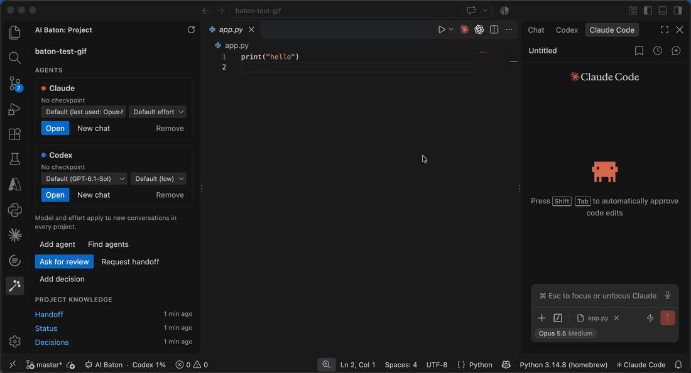
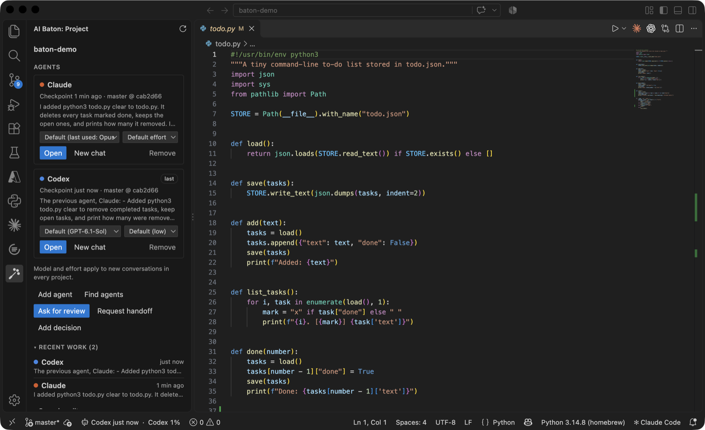
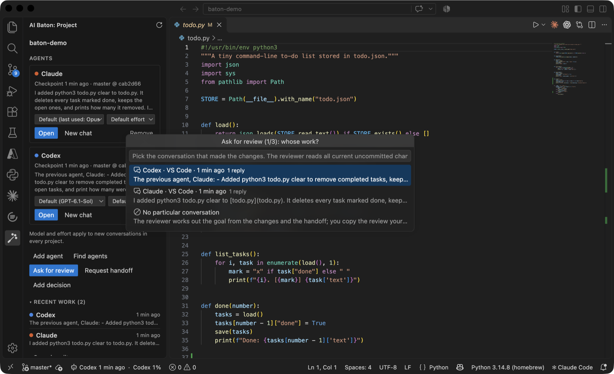
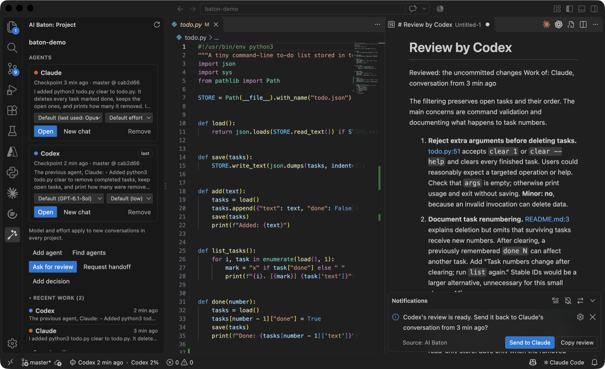
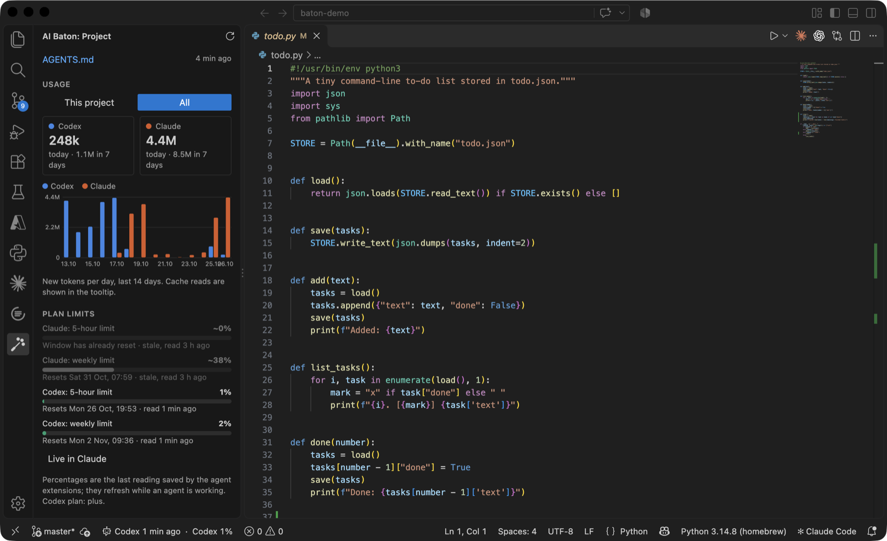

# AI Baton

**A conductor for your AI coding agents.** Claude Code and Codex take turns on one project without losing context, and one agent can review the other's work.

> Preview. Works with the Claude Code and Codex extensions, on macOS, Linux and Windows (Windows is new: tested automatically, less used so far). Get it from the VS Code Marketplace, or from Open VSX in Cursor, Windsurf and VSCodium.





## What it does

- **Shared memory between agents.** When an agent finishes a turn, AI Baton saves a checkpoint: a summary and the agent's last reply. When an agent starts a chat, it gets the other agents' latest checkpoints and its own from its previous conversation, so you do not retell what happened, even with a single agent. Checkpoints stay in your project (`.agent-memory/`, ignored by git).
- **Project knowledge in plain files.** `AGENTS.md` holds one set of rules for every agent; `docs/AGENT_HANDOFF.md`, `docs/STATUS.md` and `docs/knowledge/DECISIONS.md` hold the current state, progress and decisions. Agents read them when they start, including the same agent in a new chat.
- **Ask for review.** Pick the conversation that made the changes and a reviewer: another agent, or the same one with another model and effort for this review only (a cheap one for everyday changes, a strong one for big ones). It critiques that work read-only (the changes, with or without git; or the conversation's replies when no files changed) and gives at least three ranked points with fixes. You can send the review back to the author's conversation (it is copied; you paste it). The author is asked to say what it accepts and to wait for your "ok" before changing code. Agents also run reviews themselves when you say "ask Codex".
- **Recent work.** Sessions that saved AI Baton checkpoints, newest first, with their summaries; reopen a conversation or start a review from one.
- **Usage and limits.** Tokens per day per agent, for this project or all, and the plan limits each agent last reported.
- **Agents at a glance.** Model and effort for new conversations, which agent is working, and a warning when memory hooks are missing or not yet approved.

### Ask for review

Pick whose work to review, then the reviewer:



The review opens beside your code, and you can send it back to the author's conversation:



### Usage and limits



## Getting started

1. Install AI Baton and at least one of [Claude Code](https://marketplace.visualstudio.com/items?itemName=anthropic.claude-code) or [Codex](https://marketplace.visualstudio.com/items?itemName=openai.chatgpt).
2. Open a project folder and click the baton icon in the activity bar. If VS Code opened the folder in Restricted Mode, trust it first: AI Baton runs local commands, so it stays off (no icon) in untrusted folders.
3. Click **Initialize project**. AI Baton offers to install its memory hooks once for all projects. In the project it creates `docs/` and `.baton.json`, creates `AGENTS.md` and `CLAUDE.md` or adds an AI Baton section to existing ones (your text stays), and adds `.agent-memory/` to `.gitignore`. Without git, it also takes a first private snapshot of the files in `.agent-memory/`, so reviews can show what an agent changed.
4. Codex only: approve the hooks once. In the Codex chat box, click the hooks button next to the model picker ("Review hooks"), then **Allow all**. The panel shows a reminder until you do.

Then start a new chat in either agent.

## Requirements

- macOS, Linux or Windows (native Windows, not WSL).
- Python 3.9 or newer as `python3` on macOS and Linux (on macOS: `xcode-select --install`); on Windows Python 3.11 or newer from python.org (the `py` launcher or `python`). Or set `aiBaton.python`.
- The Claude Code and/or Codex VS Code extension, signed in.
- For **Ask for review**: a git repository or a project set up with AI Baton (without git, the changes come from AI Baton's local snapshots), and the reviewing agent's command-line tool works with your account. A review uses that agent's plan.
- Other agents (Copilot, Cline, Continue, Gemini, ...) can be added to the panel. To share memory they need AI Baton's MCP server (see Agents without hooks); otherwise, when you open one, AI Baton copies a request to load the shared context, which you paste into its chat.

## Agents without hooks (MCP)

Claude Code and Codex share memory through hooks. Other agents that speak MCP (the Model Context Protocol) can use AI Baton's local MCP server: `baton mcp --agent <id>`, started by the agent, over stdio, with no network. It gives the agent three tools: `baton_context` (what the hooks give Claude and Codex at the start of a chat), `baton_checkpoint` (save a summary of the work) and `baton_recall` (search older checkpoints). Its checkpoints show up in Recent work and reach the other agents.

For GitHub Copilot, click **Connect memory** on its card: AI Baton offers the server to VS Code itself (no settings file is edited; it works in every workspace and profile, and always runs the current CLI). **Disconnect** turns it off. This needs a VS Code with the MCP provider API; otherwise, and for other agents, add the server to the agent's MCP settings with absolute paths, for example (macOS and Linux; the extension installs the CLI in `~/.ai-baton`):

```json
{ "command": "python3", "args": ["/Users/you/.ai-baton/bin/baton", "mcp", "--agent", "copilot"] }
```

The agent decides when to call the tools: the server and the `AGENTS.md` rules ask it to call `baton_context` when a chat starts and `baton_checkpoint` after significant work. Use agent mode (Copilot's ask mode has no tools); if a chat skips them, ask it to call `baton_context`. Projects set up before this version get the rule when you run Initialize project again. `--project <folder>` limits the server to one project.

## What AI Baton stores, reads and writes

The memory hooks run locally: they never use the network or call a model. AI Baton itself sends no telemetry. The agents you use have their own network and data handling.

### In your project

- `.agent-memory/`: each checkpoint holds a summary and the agent's last reply (up to 12,000 characters, with obvious secrets such as API keys masked; this is best effort, not a guarantee), older checkpoints in a compressed archive, and which agent is working. Outside a git repository it also keeps local snapshots of the project files in `.agent-memory/shadow.git` to point at what changed. These checkpoints are given to the next agents, which send them to their providers like any other context. Delete the folder to remove all of it.
- `.baton.json`, `docs/`, `AGENTS.md`, `CLAUDE.md`, `.gitignore`, as described in Getting started.
- Project hook files (`.claude/settings.json`, `.codex/hooks.json`), only if an agent has no hooks installed for all projects.

### Automatically, when the extension starts

- `~/.ai-baton/`: the bundled command-line tool. `~/.cache/ai-baton/`: cached results.

### After you agree in the panel

- Memory hooks in `~/.claude/settings.json` and `~/.codex/hooks.json`. They run `~/.ai-baton/bin/baton` and do nothing outside projects set up for AI Baton.
- Model and effort for new conversations: Claude in `~/.claude/settings.json`, Codex in `~/.codex/config.toml`.
- Agents you add or hide: `~/.config/ai-baton/agents.json`.

### Read only

- Claude Code and Codex logs and transcripts, for token usage, session information and which program a conversation runs in: `~/.claude/projects/`, `~/.codex/sessions/`.
- Plan limits and models: `~/.claude.json`, `~/.claude/settings.json`, `~/.codex/config.toml`, `~/.codex/models_cache.json`.

### Network

- **Find agents** reads the public VS Code Marketplace listing.
- **Ask for review** runs the reviewing agent's command-line tool, which uses that agent's account and plan.

## Removing AI Baton

Uninstalling the extension does not remove the hooks it put into the agents' settings. Before uninstalling, run in a terminal:

```sh
python3 ~/.ai-baton/bin/baton uninstall-hooks
```

Add `--project <folder>` to also remove hooks from a project's own files. Then delete `~/.ai-baton`, `~/.cache/ai-baton` and `~/.config/ai-baton`. In each project you can delete `.agent-memory/` and `.baton.json`, and remove the `.agent-memory/` line from `.gitignore`. `AGENTS.md`, `CLAUDE.md` and `docs/` may hold your own work: remove only the part between `<!-- BEGIN AI-BATON -->` and `<!-- END AI-BATON -->` and the `@AGENTS.md` lines AI Baton added, and delete these files only if AI Baton created them and you no longer need them.

**Remove** on an agent's card only hides the agent in the panel; its hooks stay and its checkpoints still reach other agents.

## Good to know

AI Baton relies on details of Claude Code and Codex that are not public APIs: log and transcript formats, the cached plan usage, the links that reopen a conversation, and how Codex reports hook approval. An update to either agent can break a feature until AI Baton catches up. The rest keeps working.

## Commands

- **AI Baton: Switch Agent** (`Cmd+Alt+A` / `Ctrl+Alt+A`)
- **AI Baton: Ask Another Agent for a Review**
- **AI Baton: Show Recent Work**
- **AI Baton: Initialize Project**, **Add Agent**, **Remove Agent**, **Add Decision**, **Open Handoff**, **Copy Handoff Request**

## Settings

- `aiBaton.python`: the Python interpreter (default `python3`).
- `aiBaton.home`: leave empty to use the bundled command-line tool; set a folder to use a development checkout.
- `aiBaton.usageDays`, `aiBaton.refreshSeconds`: usage chart range and refresh interval.

## License

Source-available under the [PolyForm Shield License 1.0.0](LICENSE). Use is subject to its noncompete and notice conditions; see the license for details. Source and issues: [github.com/wwijatkowski/ai-baton](https://github.com/wwijatkowski/ai-baton).
